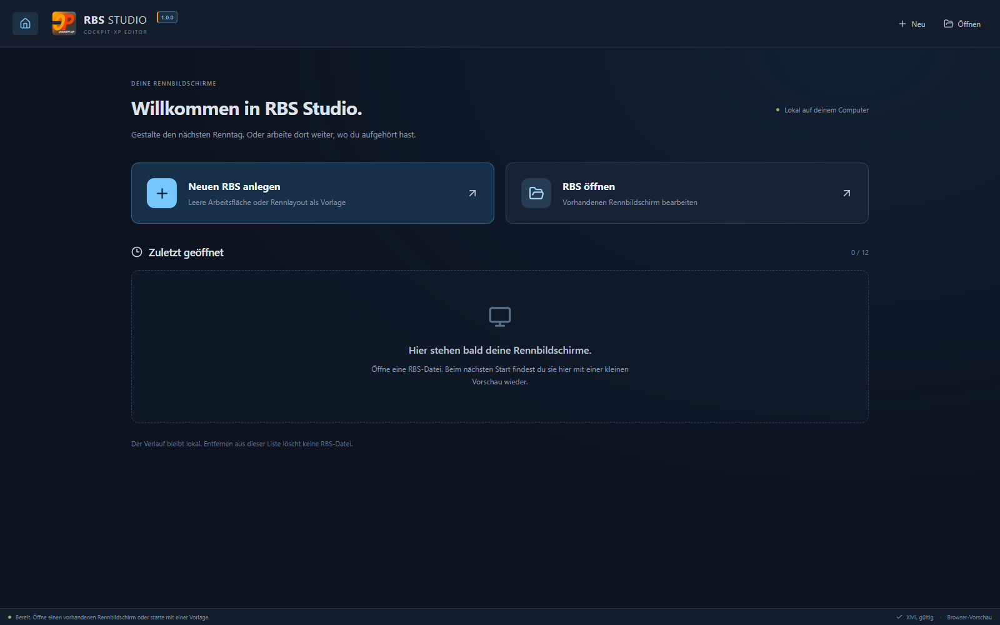
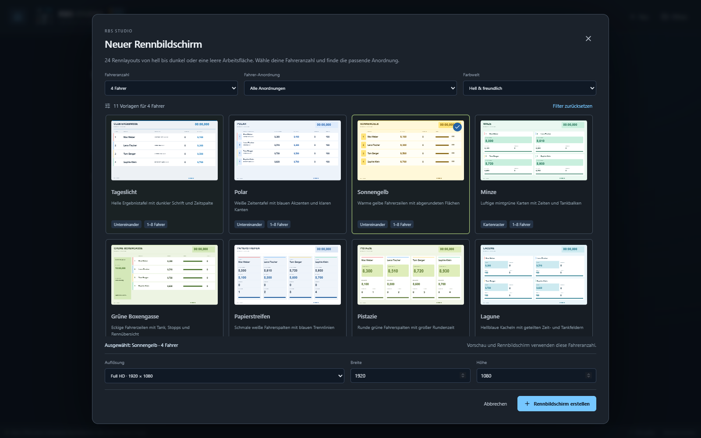
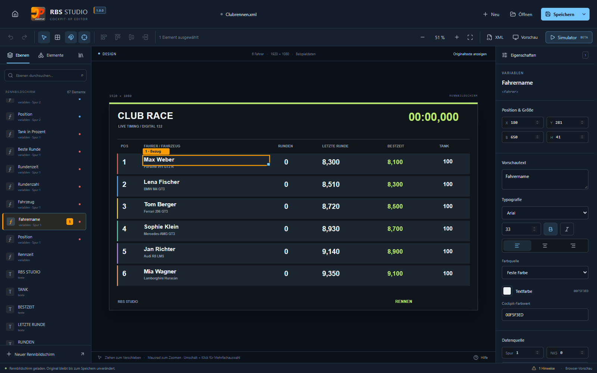
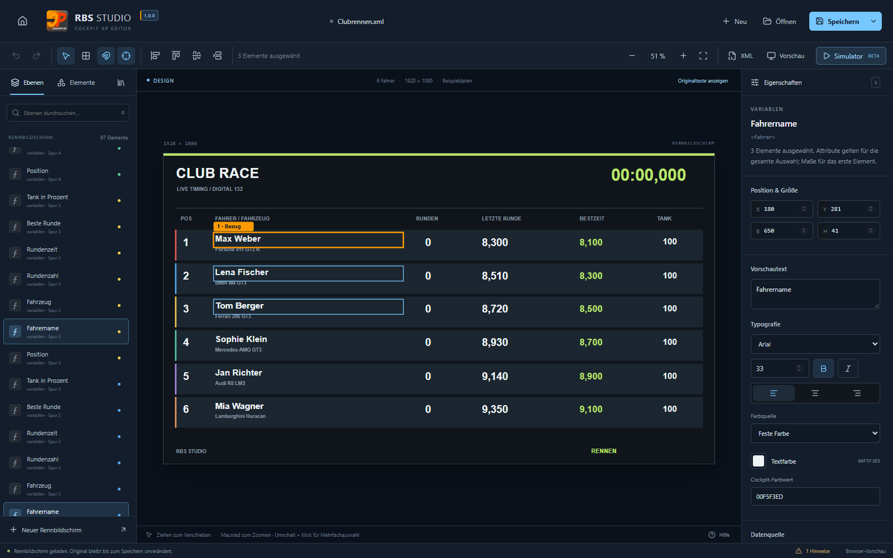
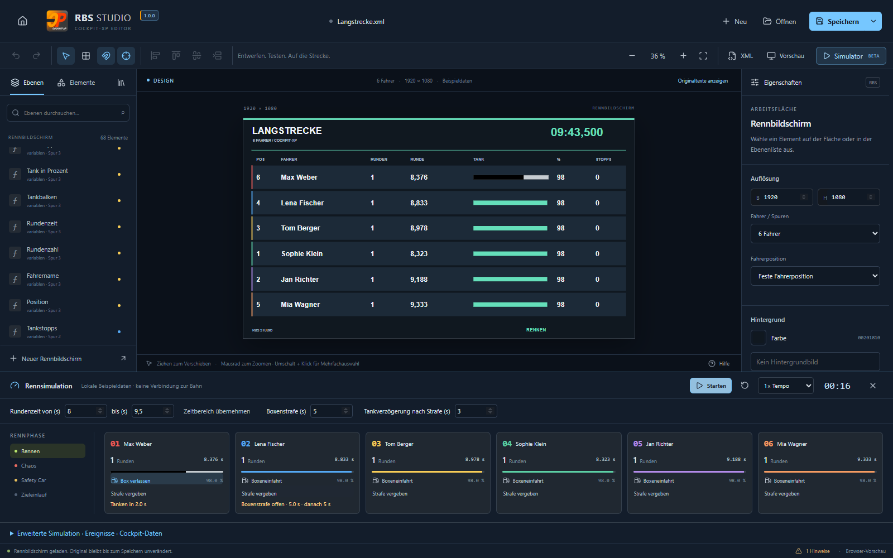

# RBS Studio

**Version 1.0.2**

Mit RBS Studio gestaltest du Rennbildschirme für Cockpit-XP. Du kannst vorhandene RBS öffnen, Texte und Anzeigen verschieben, eigene Layouts aus Vorlagen erstellen und sie mit einem simulierten Rennen ausprobieren.

[Für Windows herunterladen](https://github.com/Peschi90/CockpitXP-RBS-Studio/releases/latest) · [Installation](#installation) · [Erste Schritte](#erste-schritte) · [Bedienung](#elemente-bearbeiten) · [Rennsimulation](#rennsimulation) · [Hilfe](#hilfe-bei-problemen)

## Installation

### Mindestanforderungen

- **Windows 10 oder Windows 11 in 64 Bit** auf einem PC mit Intel- oder AMD-Prozessor (x64).
- **Microsoft Edge WebView2 Runtime** für die Programmoberfläche. Falls sie fehlt, installiert der Setup-Assistent sie automatisch nach.
- **Internetverbindung bei der Installation**, wenn WebView2 nachinstalliert werden muss. Zum anschließenden Bearbeiten lokaler Rennbildschirme ist keine Internetverbindung nötig.

**Windows 7, Windows 8/8.1 und 32-Bit-Windows werden nicht unterstützt.** Für Windows auf ARM ist dieser Installer nicht vorgesehen. Die Windows-Anforderungen gelten auch für die einzeln herunterladbare EXE.

Der Installer prüft die Windows-Version und die Prozessorarchitektur vor der Installation von WebView2 und RBS Studio. Auf einem ungeeigneten System erscheint ein Hinweis und die Installation wird beendet.

Läuft dein Cockpit-XP-Rechner noch mit Windows 7, kannst du deine Rennbildschirme auf einem geeigneten anderen PC bearbeiten. Übertrage anschließend den vollständigen RBS-Ordner einschließlich der Bilder auf den Cockpit-Rechner und prüfe den Bildschirm dort in Cockpit-XP.

### Installation durchführen

1. Öffne die [Downloadseite](https://github.com/Peschi90/CockpitXP-RBS-Studio/releases/latest).
2. Klappe bei Bedarf **Assets** auf und lade die Datei herunter, deren Name mit **x64-setup.exe** endet. Das ist der Installer für Windows-PCs mit 64-Bit-Intel- oder AMD-Prozessor.
3. Öffne die heruntergeladene Datei und folge dem Installationsassistenten.
4. Starte **RBS Studio** über das Windows-Startmenü.

Alternativ kannst du die einzeln angebotene **RBS Studio.exe** herunterladen und direkt starten. GitHub kann im Dateinamen Punkte statt Leerzeichen anzeigen.

Zum Herunterladen und gegebenenfalls Nachinstallieren benötigter Komponenten brauchst du Internet. Anschließend kannst du lokal an deinen Rennbildschirmen arbeiten. RBS Studio wird als eigenes Programm installiert.

### Updates

RBS Studio prüft bei jedem Start im Hintergrund, ob eine neuere Version bereitsteht.

- **Jetzt aktualisieren** lädt den Installer und startet ihn. RBS Studio schließt sich dafür. Folge anschließend dem Installationsassistenten.
- **Speichern und aktualisieren** speichert vorher deine offenen Änderungen. Wird das Speichern abgebrochen oder schlägt es fehl, beginnt das Update erst nach erfolgreichem Speichern.
- **Später** verschiebt das Update. Beim nächsten Programmstart wird wieder geprüft.

Während des Downloads siehst du den Fortschritt. Bei einem Downloadfehler kannst du es erneut versuchen oder später weiterarbeiten. Ohne Internet startet deine installierte Version ohne Meldung.

## Erste Schritte

### Einen vorhandenen RBS bearbeiten

1. Klicke auf der Startseite auf **RBS öffnen**.
2. Wähle die Bildschirmdatei aus, zum Beispiel **Rennen.xml** oder **Startampel.xml**.
3. Klicke auf ein Element auf der Arbeitsfläche.
4. Bearbeite rechts unter **Eigenschaften** den Text, die Position, die Schrift oder die Farbe.
5. Speichere deine Änderungen über **Speichern**. Für eine eigene Variante verwende **Speichern unter** über den kleinen Pfeil neben der Speichern-Schaltfläche.

Die mit Cockpit-XP verwendeten Rennbildschirme findest du üblicherweise unter **C:\ProgramData\Cockpit-V2\RennBildschirm**. Öffne dort den Ordner des gewünschten Bildschirms und seine Bildschirmdatei.

Über den Reiter **Bibliothek** kannst du die vorhandenen RBS direkt im Studio durchsuchen. Mit **Ordner wählen** wählst du ein anderes Verzeichnis aus.

### Auf der Startseite weiterarbeiten

Unter **Zuletzt geöffnet** erscheinen bis zu zwölf Rennbildschirme mit kleinen Vorschaubildern. Klicke auf einen Eintrag, um ihn erneut zu öffnen. Das Kreuz an einem Eintrag entfernt ihn aus dem Verlauf.

Das Haus-Symbol oben links führt zurück zur Startseite. Über **Zurück zu …** setzt du die aktuelle Bearbeitung fort. Beim ersten Start ist der Verlauf noch leer.

## Einen neuen Rennbildschirm erstellen

1. Wähle **Neuen RBS anlegen** auf der Startseite oder **Neu** in der oberen Leiste.
2. Stelle oben die **Fahreranzahl** von **1 bis 8** ein. Du siehst die dafür geeigneten Vorlagen; die Vorschauen passen sich daran an.
3. Filtere bei Bedarf nach **Fahrer-Anordnung** und **Farbwelt**, wähle eine Vorlage oder **Leere Arbeitsfläche** und stelle die gewünschte Auflösung ein.
4. Klicke auf **Rennbildschirm erstellen**.
5. Speichere deinen Bildschirm in einem eigenen Ordner, zum Beispiel als **Rennen.xml**.

**Vertikal · untereinander** zeigt Fahrerzeilen, **Horizontal · nebeneinander** Fahrerspalten. **Raster · mehrere Reihen** zeigt Kartenlayouts. Diese Filter beziehen sich auf die Anordnung der Fahrer, nicht auf Hoch- oder Querformat des Bildschirms. Unter **Farbwelt** findest du **Hell & freundlich** oder **Dunkel**.

Die Fahreranzahl ist zugleich Filter und Einstellung für den neuen RBS. Jede Vorlagenkarte zeigt ihren unterstützten Bereich. Einige breite Spaltenlayouts sind bewusst für weniger Fahrer ausgelegt. Wenn keine Vorlage passt, ändere die Fahreranzahl oder verwende **Filter zurücksetzen**; die Fahreranzahl bleibt dabei erhalten. Die leere Arbeitsfläche findest du mit **Alle Anordnungen** und **Alle Farben**.

Diese 24 gestalteten Vorlagen stehen zur Auswahl. Alle Elemente, einschließlich der runden oder eckigen Flächen, bleiben einzeln bearbeitbar.

| Vorlage | Geeignet für |
| --- | --- |
| Club Race | Übersichtliche Fahrerzeilen mit Fahrzeug, Zeiten und Tank |
| Timing Pro | Eine breite Zeitentabelle mit Abständen |
| Qualifying | Einen Schwerpunkt auf Bestzeiten |
| Langstrecke | Restzeit, Tankbalken und Tankstopps |
| Großanzeige | Große Werte zum Ablesen aus der Entfernung |
| Fahrer-Karten | Eine eigene Kachel je Fahrer |
| Boxenmauer | Senkrechte Fahrerspalten zum Vergleichen |
| Race TV | Eine kompakte Fahrerübersicht neben Zeit und Rennstatus |
| Duell | Zwei gegenüberliegende Spalten |
| Boxenmonitor | Tank, Stopps und Boxenstrafen |
| Tageslicht | Eine helle Ergebnistafel |
| Retro Timing | Eine bernsteinfarbene Rennanzeige |
| Polar | Weiße Fahrerzeilen mit blauen Akzenten, 1–8 Fahrer |
| Sonnengelb | Abgerundete Zeilen in warmem Gelb, 1–8 Fahrer |
| Minze | Runde mintgrüne Karten mit Zeiten und Tank, 1–8 Fahrer |
| Grüne Boxengasse | Eckige Zeilen mit Tank und Stopps neben einer Rennübersicht, 1–8 Fahrer |
| Zitronen-Duell | Zwei breite, runde Fahrerfelder in Weiß und Gelb, 2 Fahrer |
| Papierstreifen | Weiße Fahrerspalten mit blauen Trennlinien, 1–6 Fahrer |
| Pistazie | Runde grüne Spalten mit großer Rundenzeit, 1–4 Fahrer |
| Lagune | Eckige hellblaue Karten mit Zeit- und Tankfeldern, 1–8 Fahrer |
| Aprikose | Abgerundete Fahrerzeilen in Creme und Orange, 1–8 Fahrer |
| Startaufstellung | Eckige weiße Karten mit limettengrünen Datenfeldern, 1–8 Fahrer |
| Podium | Breite Spalten mit großer Positionsanzeige, 1–3 Fahrer |
| Gartenrennen | Sanftgrüne Fahrerzeilen neben einer großen Rennuhr, 1–8 Fahrer |

### Fahreranzahl bei einem bestehenden RBS

**Fahrer / Spuren** in den allgemeinen Eigenschaften legt fest, für wie viele Fahrer der Bildschirm gedacht ist. Zusätzliche Fahrerzeilen legst du im bestehenden Layout selbst an. Beim Erstellen aus einer Vorlage werden sie passend zur gewählten Fahreranzahl aufgebaut.

Um einen vorhandenen RBS zu erweitern, markiere die Elemente einer Fahrerzeile und verwende **Für weitere Spur kopieren…**. Wähle die **Zielspur** und den vertikalen **Abstand Y**. Passe danach bei Bedarf Positionen, Hintergrundflächen und Bildschirmhöhe an.

## Elemente bearbeiten

| Bereich | Bedienung |
| --- | --- |
| Obere Leiste | Neu anlegen, öffnen und speichern |
| Werkzeugleiste | Rückgängig, Raster, Hilfslinien, Ausrichten, Zoom und Vorschau |
| Ebenen links | Elemente auswählen, auch wenn sie sich überlagern |
| Elemente links | Texte, Rennwerte, Bilder, Flächen, Linien und Balken hinzufügen |
| Arbeitsfläche in der Mitte | Elemente auswählen und mit der Maus verschieben |
| Eigenschaften rechts | Position, Größe, Schrift, Farbe und Spur bearbeiten |

### Auswählen, verschieben und vergrößern

- Klicke auf ein Element auf der Arbeitsfläche oder in der Ebenenliste.
- Ziehe es mit gedrückter linker Maustaste an die gewünschte Stelle.
- Verwende die Pfeiltasten für Schritte von **1 Pixel**, mit **Umschalt** für **10 Pixel**.
- Trage rechts **X** und **Y** ein, wenn du eine genaue Position benötigst.
- Bei Elementen mit veränderbarer Größe kannst du die Anfasser am Auswahlrahmen oder die Felder **B** und **H** verwenden.
- Das Mausrad über der Arbeitsfläche zoomt hinein und heraus. **An Arbeitsbereich anpassen** zeigt den gesamten Bildschirm. Ein Klick auf die Prozentanzeige stellt **100 %** ein.

Ein Klick auf eine freie Stelle hebt die Auswahl auf. Rechts erscheinen dann die allgemeinen Einstellungen des Rennbildschirms, etwa Auflösung, Fahreranzahl und Hintergrund.

### Neue Anzeigen hinzufügen und einem Fahrer zuordnen

Öffne links **Elemente** und klicke auf den gewünschten Typ, zum Beispiel **Text**, **Fahrername**, **Rundenzeit** oder **Tankbalken**. Verschiebe das neue Element an die gewünschte Stelle und passe seine Eigenschaften an.

Bei fahrerbezogenen Anzeigen stellst du rechts unter **Datenquelle** die **Spur** ein. **Feste Spur / Fahrzeug-ID** ordnet die Anzeige einem bestimmten Fahrer zu. Mit **Nach Rennposition** folgt die Anzeige der Platzierung, beispielsweise dem jeweils führenden Fahrer bei Position 1. Über **NKS** legst du bei unterstützten Zahlenanzeigen die Nachkommastellen fest.

### Texte und Farben

Wähle einen Text oder eine Textanzeige aus. Rechts kannst du Schriftart, Schriftgröße, Fett, Kursiv und Ausrichtung einstellen. Bei festen Beschriftungen änderst du den Inhalt im Feld **Text**. Bei Rennwerten dient **Vorschautext** zum Beurteilen der späteren Darstellung.

Über **Farbquelle** wählst du eine feste Textfarbe oder die **Slot-Schriftfarbe**. Diese ist getrennt von der **Slot-Hintergrundfarbe**. So kannst du beispielsweise dunkle Schrift auf einem hellen Spurhintergrund verwenden.

Wenn Fahrer- oder Fahrzeugnamen abgeschnitten werden, erhöhe die **Platzhalterlänge**, sofern dieses Feld angeboten wird. Damit reservierst du mehr Platz für die Anzeige. Der Wert **0** verwendet die feste Breite oder den Vorschautext. Bei Zahlen und Zeiten bestimmt der Vorschautext das Format und die automatische Feldbreite.

### Ereignissymbole ein- und ausschalten

Wähle ein **Ereignissymbol** aus. Unter **Symbol anzeigen** und **Symbol ausschalten** wählst du die Aktion anhand ihrer Cockpit-Bezeichnung, beispielsweise **Boxengasse Strafe wurde ausgesprochen** und **Boxengasse Strafe ist beendet**. Die zugehörigen Ereignisnummern werden automatisch gespeichert.

Für eigene oder unbekannte Nummern öffne **Ereignis-ID manuell eingeben**. Unbekannte IDs aus vorhandenen RBS bleiben erhalten. **Kein Ereignis** entspricht der ID 0.

### Bilder und Hintergrund

Speichere einen neuen Rennbildschirm zuerst. Wähle anschließend ein Bildelement aus und importiere das gewünschte Bild über den Eigenschaftenbereich. Für den Hintergrund klicke auf eine freie Stelle und verwende **Hintergrund hinzufügen…**.

Für die Verwendung in Cockpit-XP eignen sich insbesondere **PNG**, **JPG** und **BMP**. Bewahre die Bilder zusammen mit dem Rennbildschirm auf.

## Mehrere Elemente ausrichten

1. Wähle zuerst das Element aus, an dem sich die anderen orientieren sollen.
2. Halte **Umschalt** oder **Strg** gedrückt und klicke weitere Elemente an.
3. Das erste Element erhält einen orangefarbenen Rahmen und die Kennzeichnung **1 · Bezug**.
4. Wähle die gewünschte Funktion in der Werkzeugleiste.

| Funktion | Ergebnis |
| --- | --- |
| Horizontal ausrichten | Alle ausgewählten Elemente erhalten die Y-Position des Bezugselements und liegen auf gleicher Höhe. |
| Vertikal ausrichten | Alle ausgewählten Elemente erhalten die X-Position des Bezugselements und liegen links auf gleicher Position. |
| Vertikal gleichmäßig verteilen | Mindestens drei ausgewählte Elemente werden mit gleichmäßigen vertikalen Abständen verteilt. |

Eine Mehrfachauswahl lässt sich gemeinsam verschieben, duplizieren oder löschen. Beim Bearbeiten mehrerer Elemente gelten die Eigenschaften für die gesamte Auswahl. Positions- und Größenfelder beziehen sich auf das erste ausgewählte Element.

### Einrasten und Hilfslinien

Aktiviere **Intelligente Hilfslinien** über das Fadenkreuz-Symbol. Beim Ziehen erscheinen lila Linien, sobald Kanten oder Mittelpunkte zu anderen Elementen oder zur Arbeitsfläche passen. Das Element rastet dort ein.

Mit demselben Schalter kannst du die Hilfslinien ausschalten. Deine Wahl wird für den nächsten Start gespeichert. Halte beim Ziehen **Alt** gedrückt, um frei zu verschieben. **Esc** bricht den aktuellen Ziehvorgang ab.

Das sichtbare **Raster** und das Einrasten am **8-Pixel-Raster** schaltest du getrennt über das Raster- und das Magnet-Symbol ein oder aus.

## Vorschau und Rennsimulation

### Darstellung prüfen

Über **Vorschau** beurteilst du deinen Rennbildschirm ohne die Bearbeitung auf der Fläche. Über **Originaltexte anzeigen** beziehungsweise **Beispieldaten anzeigen** wechselst du zwischen den gespeicherten Vorschautexten und den Beispieldaten.

Prüfe insbesondere lange Fahrernamen, große Rundenzahlen, Textfarben und Tankanzeigen. Kontrolliere den gespeicherten Bildschirm vor dem Renneinsatz auch in Cockpit-XP. Einzelne Darstellungen können abweichen.

### Rennsimulation

1. Öffne **Simulator** in der Werkzeugleiste.
2. Gib bei **Rundenzeit von (s)** und **bis (s)** den gewünschten Bereich ein, zum Beispiel **8,0 bis 9,5 Sekunden**.
3. Klicke auf **Zeitbereich übernehmen**.
4. Starte das Rennen mit **Starten**.

Die Fahrer erhalten unterschiedliche zufällige Rundenzeiten. Ein neuer Zeitbereich gilt ab der nächsten neu begonnenen Runde. Boxenaufenthalte verlängern die tatsächlich gemessene Runde.

Mit **Pause** hältst du die Simulation an. Über die Tempoauswahl kannst du sie mit **1×, 2×, 5× oder 10×** laufen lassen. Die Rennphasen **Rennen**, **Chaos**, **Safety Car** und **Zieleinlauf** helfen dir, verschiedene Anzeigen auszuprobieren. Das Symbol zum Zurücksetzen beginnt einen neuen Simulationslauf.

#### Tanken und Boxenstrafen

- **Boxeneinfahrt** bringt den jeweiligen Fahrer in die Box. **Box verlassen** setzt seine Fahrt fort.
- Auf der Strecke wird der Tankstand beim Rundenwechsel aktualisiert. In der Box steigt er während des Tankens laufend.
- Stelle unter **Boxenstrafe (s)** die gewünschte Dauer ein und klicke beim Fahrer auf **Strafe vergeben**. Mehrere Klicks vergeben mehrere Strafen, die nacheinander abgesessen werden.
- Verlässt der Fahrer die Box vorzeitig, beginnt die unterbrochene Strafe beim nächsten Stopp wieder mit ihrer vollen Dauer. Bereits abgesessene Strafen sind erledigt.
- Nach der letzten Strafe folgt die **Tankverzögerung nach Strafe (s)**, voreingestellt auf **3 Sekunden**. Der Tankbalken wird schwarz und läuft rückwärts ab. Danach zeigt er wieder den Tankstand und das Tanken beginnt.
- Bei einem gewöhnlichen Tankstopp ohne Strafe beginnt das Tanken sofort.

### Echte Cockpit-Daten anzeigen

Wenn die Cockpit-API in deinem Cockpit-XP aktiviert ist, öffne im Simulator **Erweiterte Simulation · Ereignisse · Cockpit-Daten**. Trage unter **Cockpit-API** die Adresse ein, zum Beispiel **http://localhost:8080**, und wähle **Live-Daten verbinden**. Einen abweichenden Port kannst du direkt in der Adresse ändern.

Über **Live-Daten trennen** beendest du die Verbindung. Für die lokale Rennsimulation wähle danach die Rennphase **Rennen** und **Starten**.

## Speichern und in Cockpit-XP verwenden

**Speichern** übernimmt die Änderungen in die geöffnete Datei. **Speichern unter** über den Pfeil neben **Speichern** legt eine Kopie an. Für eine eigene RBS-Variante wähle einen neuen Ordner und verwende dort beispielsweise den Dateinamen **Rennen.xml**.

Beim Speichern einer Kopie übernimmt RBS Studio die zugehörigen, in der Datei verwendeten Bilder. Weitere Bildschirmdateien, etwa eine separate Startampel, übernimmst du bei Bedarf zusätzlich.

1. Speichere den fertigen Rennbildschirm in deinem Cockpit-RBS-Verzeichnis.
2. Wähle ihn in Cockpit-XP als Rennbildschirm aus.
3. Prüfe dort Auflösung, Fahrerzuordnung, Bilder und Textdarstellung.

### Sicherungen und Wiederherstellung

Beim Überschreiben einer geänderten Datei legt RBS Studio eine Sicherung des vorherigen Stands im selben Ordner an. Du erkennst sie an **rbs-studio**, einem Zeitstempel und der Endung **.bak**. Zum Wiederverwenden kopierst du die gewünschte Sicherung unter einem neuen Namen mit der Endung **.xml**.

Falls eine Datei seit dem Öffnen von einem anderen Programm geändert wurde, meldet RBS Studio den Konflikt. Speichere deine Bearbeitung dann unter einem anderen Namen und vergleiche die beiden Stände.

Nach einer unterbrochenen Arbeit kann beim nächsten Start **Ein ungespeicherter Arbeitsstand ist vorhanden** erscheinen. Wähle **Wiederherstellen**, um daran weiterzuarbeiten, und speichere anschließend die Datei.

## Tastenkürzel

Die Bearbeitungskürzel gelten auf der Arbeitsfläche, wenn du gerade keinen Text in einem Eingabefeld bearbeitest.

| Taste | Aktion |
| --- | --- |
| Strg + O | Rennbildschirm öffnen |
| Strg + S | Speichern |
| Strg + Umschalt + S | Speichern unter |
| Strg + Z | Rückgängig |
| Strg + Y oder Strg + Umschalt + Z | Wiederholen |
| Strg + D | Auswahl duplizieren |
| Strg + A | Alle Elemente auswählen |
| Entf | Auswahl löschen |
| Pfeiltasten | Auswahl um 1 Pixel verschieben |
| Umschalt + Pfeiltasten | Auswahl um 10 Pixel verschieben |
| Umschalt oder Strg + Klick | Elemente zur Auswahl hinzufügen oder daraus entfernen |
| Alt beim Ziehen | Einrasten vorübergehend übergehen |
| Esc beim Ziehen | Verschieben abbrechen |
| Mausrad über der Arbeitsfläche | Hinein- oder herauszoomen |

## Hilfe bei Problemen

| Problem | Was du tun kannst |
| --- | --- |
| Ein Text wird abgeschnitten. | Wähle die Anzeige aus und prüfe Platzhalterlänge, Feldbreite, Vorschautext und Schriftgröße. |
| Schrift ist auf einer Spurfarbe schlecht lesbar. | Prüfe die Farbquelle. Verwende eine passende feste Farbe oder die separate Slot-Schriftfarbe. |
| Bilder fehlen. | Öffne den RBS aus seinem vollständigen Ordner. Prüfe, ob die Bilddateien vorhanden sind, oder importiere das Bild erneut. |
| Ein Eintrag unter „Zuletzt geöffnet“ lässt sich nicht öffnen. | Die Datei wurde möglicherweise verschoben oder umbenannt. Öffne sie über „RBS öffnen“ am aktuellen Speicherort. |
| Die Simulation läuft nicht weiter. | Prüfe „Starten“, die Rennphase und den Boxenstatus. „Chaos“ hält das Rennen an. Nach „Zieleinlauf“ setze die Simulation zurück. |
| Eine Änderung lässt sich nicht speichern. | Lies die angezeigte Meldung und versuche bei einem Dateikonflikt „Speichern unter“ in einem eigenen Ordner. |
| Cockpit-XP zeigt einen anderen Stand. | Prüfe, ob du die richtige Datei gespeichert und den passenden Bildschirm in Cockpit-XP ausgewählt hast. Lade ihn dort erneut. |

Für Fehlerberichte nutze die [GitHub-Issues](https://github.com/Peschi90/CockpitXP-RBS-Studio/issues). Beschreibe die betroffene Programmversion, deine Arbeitsschritte, das erwartete Ergebnis und das tatsächliche Verhalten. Ein Screenshot der Stelle hilft bei der Einordnung.

RBS Studio ist ein eigenständiges Projekt für Cockpit-XP.
